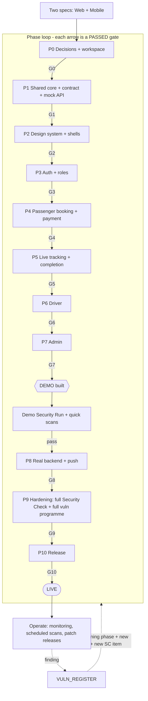

# RedTaxi — End-to-End Pipeline (start to finish)

> Part of the RedTaxi delivery pack. Start at [README.md](README.md).
> Related: [IMPLEMENTATION.md](IMPLEMENTATION.md) (what is built) · [TESTING.md](TESTING.md) (gate rules) · [SECURITY_CHECK.md](SECURITY_CHECK.md) · [VULNERABILITY.md](VULNERABILITY.md)
> Ready-to-use workflows: [`.github/workflows/ci.yml`](.github/workflows/ci.yml) · [`security.yml`](.github/workflows/security.yml) · [`eas.yml`](.github/workflows/eas.yml)

## 1. The Whole Journey on One Page

There are **two loops** running together:

- **The phase loop (human + gate script):** build a phase → run its gate → only on a pass start the next phase.
- **The delivery loop (automation):** every change → CI → preview → staging → production, with security scans alongside.



Failure at any gate → stay in the phase (see [TESTING.md §6](TESTING.md#6-when-a-gate-fails)).

## 2. Stage-by-Stage Map (start → end)

| # | Stage | Trigger | What runs | Evidence / output | Blocks next? | Documents |
|---|-------|---------|-----------|-------------------|--------------|-----------|
| 1 | **Decide** | Project start | Resolve spec conflicts in `docs/DECISIONS.md` | Signed decision register | Yes (G0) | [Phase 0](IMPLEMENTATION.md#phase-0-decisions-and-workspace), [Gate 0](TESTING.md#gate-0-decisions-and-workspace) |
| 2 | **Scaffold** | After decisions | Monorepo, lint/type/env, CI skeleton, secret scan | Green CI on `main` | Yes (G0) | Phase 0 |
| 3 | **Core** | Gate 0 passed | Shared domain, fare, state machine, OpenAPI, mock API | 100% coverage on money/state code, contract tests | Yes (G1) | [Phase 1](IMPLEMENTATION.md#phase-1-shared-core-and-api-contract) |
| 4 | **Design system** | Gate 1 passed | Tokens, components, layouts | Component tests, axe 0 serious | Yes (G2) | [Phase 2](IMPLEMENTATION.md#phase-2-design-system-and-app-shells) |
| 5 | **Auth** | Gate 2 passed | BFF sessions, middleware, OTP, admin MFA | Auth tests + Security subset G3 | Yes (G3) | [Phase 3](IMPLEMENTATION.md#phase-3-authentication-and-roles), SC-A, SC-B |
| 6 | **Passenger booking** | Gate 3 passed | WP1–WP5, MP4–MP8, payments (test mode) | E2E web + mobile, Lighthouse, SC-C | Yes (G4) | [Phase 4](IMPLEMENTATION.md#phase-4-passenger-booking-and-payment) |
| 7 | **Tracking** | Gate 4 passed | Realtime, SOS, share, rating | E2E with driver simulator, SC-E | Yes (G5) | [Phase 5](IMPLEMENTATION.md#phase-5-live-tracking-and-trip-completion) |
| 8 | **Driver** | Gate 5 passed | Offers, trip steps, earnings, documents | E2E, SC-B3/B5/F3/F4/G2 | Yes (G6) | [Phase 6](IMPLEMENTATION.md#phase-6-driver-experience) |
| 9 | **Admin → DEMO** | Gate 6 passed | Verification, dispatch, pricing, tickets, analytics | E2E, **Demo Security Run**, quick scans | Yes (G7) | [Phase 7](IMPLEMENTATION.md#phase-7-admin-operations) |
| 10 | **Real backend** | Gate 7 passed + backend owner | Contract tests on staging, webhook, push, load | All E2E on staging, k6 | Yes (G8) | [Phase 8](IMPLEMENTATION.md#phase-8-real-backend-integration-and-notifications) |
| 11 | **Harden** | Gate 8 passed | **Full** Security Check, **full** vulnerability programme, a11y, perf, privacy | Run log + vuln register clean of Critical/High | Yes (G9) | [Phase 9](IMPLEMENTATION.md#phase-9-hardening-security-vulnerabilities-performance-accessibility-privacy) |
| 12 | **Release** | Gate 9 passed | Production deploy, EAS production builds, store submission, rollback drill | Post-deploy smoke + security smoke | Yes (G10) | [Phase 10](IMPLEMENTATION.md#phase-10-release-and-launch) |
| 13 | **Operate** | Live | Monitoring, weekly/monthly scans, patch releases | Dashboards, register updates | — | [VULNERABILITY.md §2](VULNERABILITY.md) |

## 3. CI — runs on every pull request ([`ci.yml`](.github/workflows/ci.yml))

```
push/PR
  └─ static ──────── lint · typecheck (strict TS, all workspaces)
       ├─ unit ────── shared (coverage) · mock-api · web (Vitest) · mobile (Jest)
       ├─ contract ── Spectral lint of openapi.yaml · Schemathesis vs mock API
       │      └─ build-web ── next build with CI-only env
       │             └─ e2e-web ── Playwright + axe against mock API
       └─ mobile-checks ── expo-doctor · expo export (bundling proof)
  phase-gate-policy ── fails if a phase stamp exists without its predecessor
```

Merge rules for `main`: all jobs above **and** the `security` workflow's `secrets`, `dependencies`, `sast`, `config-scan` jobs must pass; one review; no direct pushes.

Mobile native E2E (Maestro) and device tests run on EAS/emulators nightly and at gates because they are slow; they are mandatory in the gate commands ([`scripts/gates.conf`](scripts/gates.conf)).

## 4. Security Pipeline ([`security.yml`](.github/workflows/security.yml))

| Job | Scan (ID in [VULNERABILITY.md](VULNERABILITY.md)) | When | Fails on |
|-----|-----------------------|------|----------|
| `secrets` | VU-S2 gitleaks, full history | PR, weekly | any finding |
| `dependencies` | VU-S1 `pnpm audit`, VU-S7 SBOM, dependency review | PR, weekly | High/Critical |
| `sast` | VU-S3 Semgrep OWASP/TS/React | PR | High/Critical |
| `config-scan` | VU-S4 Trivy fs/misconfig | PR, weekly | High/Critical |
| `dast-staging` | VU-S5 ZAP baseline + [`security-smoke.sh`](scripts/security-smoke.sh) (subset of [SECURITY_CHECK.md](SECURITY_CHECK.md)) | manual / monthly on **staging only** | High |

What is **not** automated and therefore lives in the gates: authenticated checks (cookies, IDOR, payments, sockets, uploads, mobile storage), the targeted `VU-T` attack tests, MobSF/MASVS on release builds. They are executed by a person at Gates 3–9 and logged in `docs/SECURITY_RUN_LOG.md`.

## 5. Environments

| Environment | Purpose | API | Payments | Keys | Data | Who deploys |
|-------------|---------|-----|----------|------|------|-------------|
| **Local** | Development | Mock API (`services/mock-api`) | Razorpay **test** | dev keys, `.env.local` (git-ignored) | seed from designs | developer |
| **Preview** (per PR) | Review | Mock API | test | CI placeholders | seed | CI |
| **Demo** | End of Phase 7 | Mock API or staging | test | demo keys | seed | CI on tag `demo-*` |
| **Staging** | Phase 8–10 | **Real backend (staging)** | Razorpay **test** | staging keys (restricted) | synthetic, no real PII | CI on `main` |
| **Production** | Live | Real backend | Razorpay **live** | prod keys (restricted, rotated) | real | CI on release tag, after Gate 9 |

Config rules (from web §2.2 and §12): Zod-validated env at boot; **no secrets in `NEXT_PUBLIC_*`**; Maps key restricted by referrer/API; Razorpay secret server-only; separate keys per environment; mobile keys injected via `app.config.ts` at build time.

## 6. Delivery (CD)

### 6.1 Web (Next.js)
Hosting is not specified in the web spec. Any host supporting Next.js App Router, ISR and an always-on socket endpoint works (managed Next hosting or containers). Whatever you pick, the stages are:

1. Tag `vX.Y.Z` on `main` → CI green → build once, promote the **same artifact** staging → production.
2. Staging deploy → run `pnpm smoke:staging` and `scripts/security-smoke.sh` against staging.
3. Production deploy behind feature flags; staged rollout (e.g. 5% → 25% → 100%) watching error rate and payment failures.
4. Upload source maps and create a Sentry release; keep source maps off the public site.
5. Run production smoke (T10.7) and `WEB=$PROD_URL scripts/security-smoke.sh` (T10.8).

### 6.2 Mobile (Expo / EAS) ([`eas.yml`](.github/workflows/eas.yml))
One codebase → three store apps with `APP_VARIANT=passenger|driver|admin` (distinct name, bundle ID, icon).

| Profile | Use | Notes |
|---------|-----|-------|
| `development` | Dev client (needed for Razorpay, Google/Apple sign-in) | not Expo Go |
| `preview` | Internal testers, UAT, Maestro | points at staging |
| `production` | Store builds | **workflow refuses to run unless `signoff/phase-9.passed` exists** |

- **OTA (EAS Update)**: JS-only fixes. Native changes (new permission, new module) require a store build.
- Store submissions need: privacy policy URL, data-safety/privacy forms, permission justifications, and for the driver app the **background-location review text** (mobile spec §12).
- Run MobSF/MASVS checks (VU-S6) on the **release** artifact before submitting.

### 6.3 Backend (outside the specs)
The specs only suggest a contract. The backend pipeline must run: contract tests (T8.1), webhook tests (T8.3), load tests (T8.8–T8.9), DB migrations with rollback, and the same security scans. Ownership is decision **DEC-12**.

## 7. Where Gates Plug Into the Pipeline

| Gate | Enforced by | How |
|------|-------------|-----|
| Phase order | [`scripts/start-phase.sh`](scripts/start-phase.sh), CI job `phase-gate-policy` | refuses / fails if predecessor stamp missing |
| Phase pass | [`scripts/gate.sh`](scripts/gate.sh) | runs `gates.conf` commands + regression + sign-off check, writes `signoff/phase-N.passed` |
| Demo security | Gate 7 command in `gates.conf` | requires `Run: Demo` in `docs/SECURITY_RUN_LOG.md` with no `FAIL` |
| Full security + vulns | Gate 9 commands | requires `Run: Full`, no open Critical/High in `docs/VULN_REGISTER.md`, scans green |
| Production mobile build | `eas.yml` | blocks without `phase-9.passed` |
| Launch | Gate 10 | smoke + security smoke on production |

Commit the `signoff/*.passed` stamps and `phase-N.md` files: they are the audit trail ("who approved what, on which commit").

## 8. Release and Rollback Runbook

**Release checklist (before tagging):** Gate 9 stamp present · register has no Critical/High open · SBOM stored · store paperwork ready · feature flags set · on-call named.

**Rollback:**
| Layer | Action | Target time (set and drill it) |
|-------|--------|-------------------------------|
| Web | Redeploy previous build/tag; flip feature flag off | minutes |
| Mobile JS | EAS Update rollback to previous update | minutes |
| Mobile native | Halt staged rollout in the stores; ship a fix build | hours–days |
| Backend | Roll back release + DB migration plan | per backend runbook |
| Payments | Pause new orders via flag; reconcile via webhook/orders report | immediate |

The rollback drill is required by [T10.2](TESTING.md#gate-10-release): do it before launch, record the time.

## 9. Operate: Monitoring and Scheduled Work

| Signal | Source | Alert on |
|--------|--------|----------|
| Errors | Sentry (web + mobile, releases tracked) | new issue spike after release |
| Web vitals | `web-vitals` → analytics | LCP > 2.5 s regression |
| Payments | webhook/orders reconciliation job | any unmatched paid order |
| OTP / SMS | provider spend + `otp/send` 429 rate | spend spike (SMS pumping, VU-T2) |
| Sockets | disconnect rate, connection count | sustained drop |
| Maps quota | cloud console budget | threshold alert (VU-T20) |
| Security | weekly `security.yml`, monthly ZAP on staging | any High/Critical |

Every finding returns to the loop in [VULNERABILITY.md §8](VULNERABILITY.md): register → fix → regression test → **new Security-Check item** → retest.

## 10. Who Does What (adjust names)

| Role | Owns |
|------|------|
| Product owner | Decisions (Phase 0), UAT sign-off (Gate 10), waivers for *Should* items |
| Tech lead | Gate scripts, CI, branch protection, final gate approvals |
| Web / Mobile devs | Phases 2–7 implementation, unit/component/E2E tests |
| Backend owner | Real API (Phase 8), contract, webhook, load tests |
| Security lead (or a dev not on the feature) | Security Check runs, vuln scans/tests, retests |
| Ops lead | Admin UAT (M7.1), runbooks, on-call |

The person who **fixes** a vulnerability must not be the one who **retests** it.

## 11. Cross-Reference Cheat Sheet

| If you need… | Go to |
|--------------|-------|
| What to build in phase N | [IMPLEMENTATION.md](IMPLEMENTATION.md) → *Phase N* |
| Exact tests that must pass for phase N | [TESTING.md](TESTING.md) → *Gate N* |
| Is a promised protection really on? | [SECURITY_CHECK.md](SECURITY_CHECK.md) → `SC-*` |
| Can it still be attacked? | [VULNERABILITY.md](VULNERABILITY.md) → `VU-S*`, `VU-T*`, `VR-*` |
| How the automation is wired | this file + `.github/workflows/*` + `scripts/*` |
